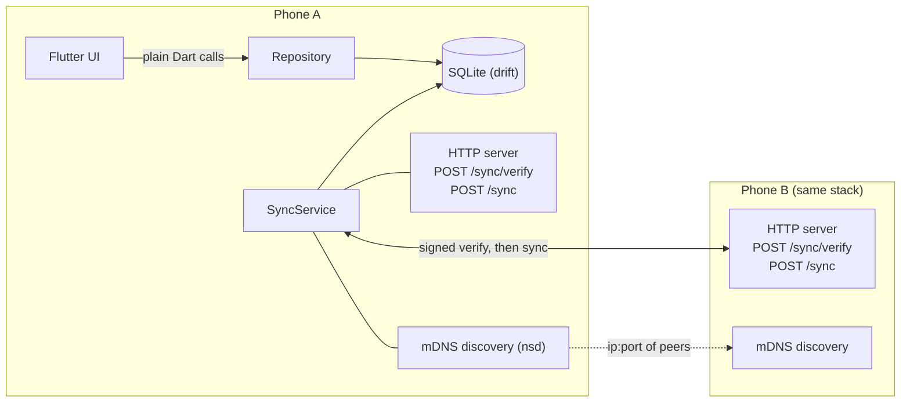
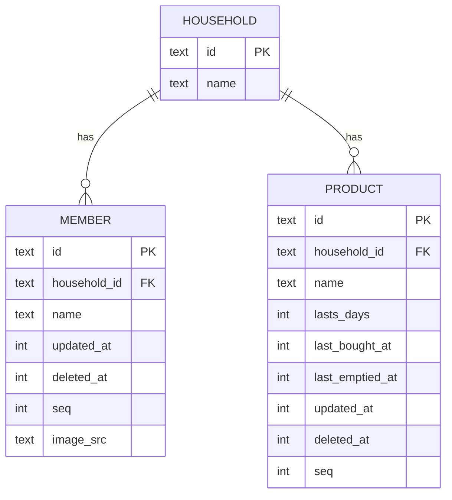
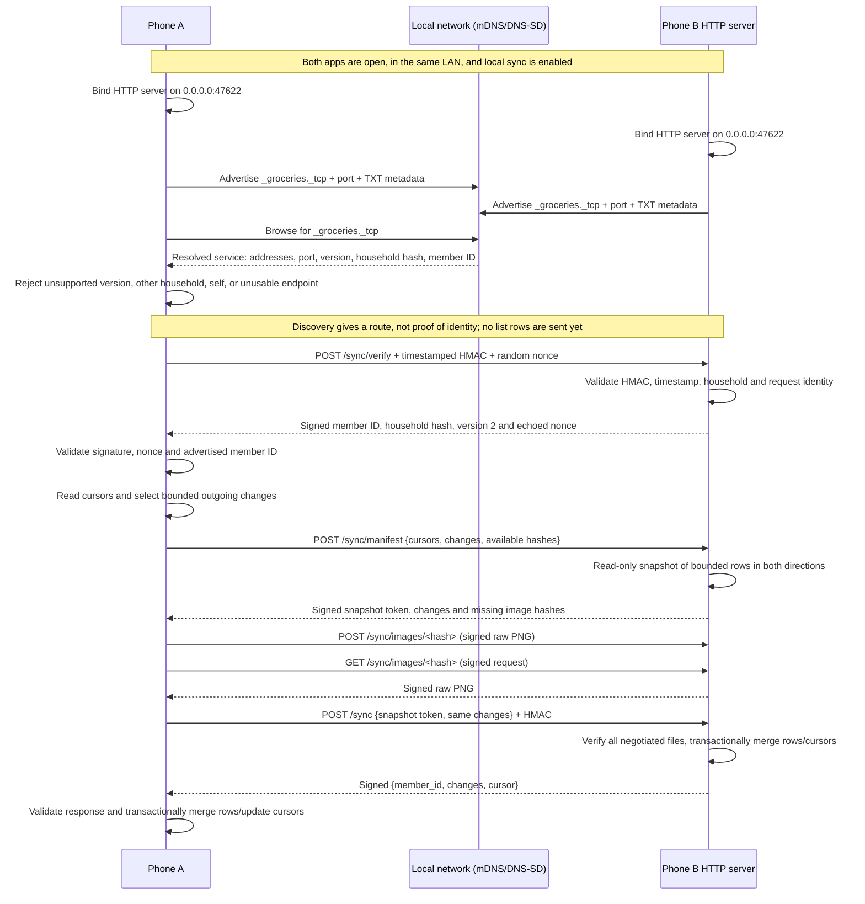

# No se que hay en la heladerApp

An app that remembers for you what needs to be bought for the house!

 
## 1. Requirements
 
### Functional
 
- **Shopping list**
  - Add products.
  - Edit product names after creation.
  - Each product has a "lifetime" (`lasts_days`); when it expires it shows up as *missing* automatically.
  - Mark a product as bought (one tap).
  - Mark a product as empty (one tap).
  - View the shopping list (what is missing).
  - Show empty products first

### Home screen

- Show products in a scrollable grid with four columns and square cells.
- Each cell shows the product image when one is available, with the product
  name below it. Do not draw a card or square background around the image;
  leave the image and name visually unboxed. Use a placeholder icon when there
  is no saved image.
- Show available/bought product images in full color. Show products that need
  buying in grayscale.
- A short tap toggles status: a product that needs buying is marked bought;
  an available product is marked empty. Use the existing repository operations
  so changes persist and sync as before.
- A long press opens the product actions: **Cambiar nombre**,
  **Cambiar duración**, and **Eliminar**.
- Keep the **Todo / Para comprar** filter, **Agregar** flow, and household and
  people management button available on the home screen.

### App background

- Use a shared decorative background across the app, behind screen content.
- The base color is warm beige (`#f5f0df`) with scattered kitchen-style SVG
  icons in gold (`#eec364`): spoon, fork, mug, heart, and star. Do not use
  knives or other sharp utensils; preserve the mug and spoon's white highlights.
- Scatter icons deterministically for each screen size, with a minimum gap
  between their bounding circles. Allow icons to be cropped at screen edges.
- Fade the icons toward the center with an elliptical radial mask: about 6%
  opacity in the center, ramping to full visibility near the edges. Keep the
  mask on the icons only so the base color remains solid.
- Keep the palette in the app theme and ensure the background does not intercept
  input or draw over screen content.

- **Sync with other people in the household**
  - Over local WiFi / LAN, no server, no third parties.
  - Consolidates the lists of everyone in the house.

### Non-functional
 
- Android first, iOS later (sisters have iPhones). Flutter, one codebase.
- Scale: 2 people now, designed for up to ~10 per household.
- Easy pairing: QR code, then automatic discovery.
- **CAP**: we choose Availability + Partition tolerance. The app always works offline; consistency is eventual. If an item gets bought twice, that's not a problem.
- **Zero friction**: every action is a tap. No quantities, no confirmation dialogs, no typing amounts.
- Only someone holding the household secret can join or sync (see [Security](#6-pairing-and-security)).

### Non-goals (v1)
 
- Quantities. A product lasts `lasts_days` whether you bought 1 or 20.
- Purchase history / analytics.
- Syncing when not on the same network.
- Real admin roles (nothing central can enforce them).


## 2. Architecture
 
Each phone is fully self-contained and works offline. Two phones sync directly when they can reach each other on the same network.
 

 
A standalone copy of this diagram is in [`architecture.svg`](./architecture.svg).
 
Key points:
 
1. **UI → backend is not HTTP.** UI and logic live in the same process, so the "API" is a Dart repository class. The network-reachable endpoints are signed sync and image-transfer routes.
2. **mDNS is discovery only.** It returns `ip:port` of peers in the household. The actual sync is a direct HTTP request to that address.
3. **Sync triggers**: app comes to foreground, a peer appears via mDNS, and after a local write (debounced). iOS can't sync in the background, and that's fine.

## 3. Data model
 
All ids are **UUIDs generated on the device** (no auto-increment ids, so offline devices never collide). Times are UTC epoch milliseconds.
 
```sql
CREATE TABLE household (
  id          TEXT PRIMARY KEY,
  name        TEXT NOT NULL
);
 
CREATE TABLE member (
  id            TEXT PRIMARY KEY,           -- also the device/install identity
  household_id  TEXT NOT NULL REFERENCES household(id),
  name          TEXT NOT NULL,
  updated_at    INTEGER NOT NULL,
  deleted_at    INTEGER,
  seq           INTEGER NOT NULL            -- local sync sequence, see §5
);
 
CREATE TABLE product (
  id               TEXT PRIMARY KEY,
  household_id     TEXT REFERENCES household(id), -- nullable for existing local rows; new products require a household
  name             TEXT NOT NULL,
  lasts_days       INTEGER NOT NULL,
  last_bought_at   INTEGER,                 -- NULL = never bought
  last_emptied_at  INTEGER,                 -- NULL = never marked empty
  updated_at       INTEGER NOT NULL,        -- covers name, lasts_days, deleted_at
  deleted_at       INTEGER,                 -- soft delete
  seq              INTEGER NOT NULL,
  image_src        TEXT                     -- drawings/<sha256>.png, nullable
);
 
-- Local only, never synced
CREATE TABLE peer (
  member_id    TEXT PRIMARY KEY,
  pull_cursor  INTEGER NOT NULL DEFAULT 0,  -- highest of THEIR seq I have received
  push_cursor  INTEGER NOT NULL DEFAULT 0   -- highest of MY seq I have sent them
);
 
CREATE TABLE local_state (
  key    TEXT PRIMARY KEY,                  -- 'seq_counter', 'household_secret', ...
  value  TEXT NOT NULL
);
```

Existing unassigned local products are assigned to a household when one is
created or joined. New products can only be added after a household exists.
Schema version 2 adds nullable `product.image_src`; version 1 installs are
migrated in place. PNG files live under the app documents directory in
`drawings/`, named by their SHA-256. Product rows store only the relative path.
 

 
### Derived status (never stored)
 
There is no `in_fridge` column. It's computed when displaying:
 
```
needs_buying(p) =
     p.last_bought_at IS NULL
  OR p.last_emptied_at > p.last_bought_at
  OR now >= p.last_bought_at + p.lasts_days * 1 day
```
 
- Tap **Bought** → `last_bought_at = now`. That is later than any earlier `last_emptied_at`, so the product is no longer missing.
- Tap **Empty** → `last_emptied_at = now`. The product shows as missing immediately.
- No background job is needed to flip products to "missing", because the status is computed on read.
### Sync identity
 
- `member.id` doubles as the device id. One install = one member.
- Users are minimal: `id` + display name.

## 4. Merge rules
 
Merging is per row, when an incoming row `r` meets a local row `l` with the same id. These rules are **commutative, associative and idempotent**, so it doesn't matter in what order or how many times rows are applied.
 
| Field | Rule |
|---|---|
| `last_bought_at` | `max(l, r)` (NULL counts as smallest) |
| `last_emptied_at` | `max(l, r)` |
| `name`, `lasts_days`, `deleted_at` | take the whole group from the row with the greater `updated_at`; tie-break by the greater `member_id` of the last writer |
| `image_src` | immutable after creation: keep a local non-null reference, otherwise adopt the incoming reference |
 
Consequences:
 
- Two people both buy milk offline: both timestamps arrive, the later one wins, and one purchase is "dropped". **This is accepted by design.**
- Buy and empty happen on different phones: both timestamps are kept, and the status is derived from the two. No lost update.
- Delete vs. edit: whoever has the later `updated_at` wins. It's a grocery list, so that's fine.
- Clock drift between phones can make a timestamp slightly wrong. Worst case is a product showing as missing a bit early or late. If it ever matters, upgrade `updated_at` to a hybrid logical clock; the schema doesn't change.


## 5. Sync protocol
 

 
### Discovery, servers, and data exchange

Each phone runs the same two network roles at once:

- **HTTP server:** when local sync is activated, the app binds an HTTP server to
  all IPv4 interfaces (`0.0.0.0`) on port `47622`. This lets another device on
  the local network reach it. The server exposes `POST /sync/verify`,
  `POST /sync/manifest`, `POST /sync`, and authenticated binary
  `GET`/`POST /sync/images/<sha256>` routes.
- **mDNS/DNS-SD advertiser and browser:** each phone registers and searches for
  the service type `_groceries._tcp`. Its DNS-SD TXT metadata contains `v`
  (protocol version), `hh` (SHA-256 hash of the household ID), and `mid` (the
  stable member/device ID). It does not publish the household secret or grocery
  rows.

mDNS/DNS-SD is local-network service discovery: it lets a device ask which
nearby devices offer a named service and resolves those services to reachable
addresses and a port. It avoids guessing or scanning IP ranges. Image sync
requires protocol version `2`, a matching household hash, a different member
ID, a valid port, and usable resolved addresses. Version 1 advertisements are
recognized so those peers receive an explicit incompatible-version response.
The stable member ID identifies a peer; its IP address is only a replaceable
route and may change.

Discovery metadata is not trusted authentication. Another device can observe
or forge an advertisement, so the app first sends `POST /sync/verify` with no
list data. That request and its response are signed with the household's shared
secret using HMAC-SHA256 and a timestamp. The client also includes a fresh
random nonce; the response must echo it, identify the same member ID that
mDNS advertised, and declare protocol version 2. Older peers are rejected
with an explicit update-both-devices error.

Before row exchange, the initiator sends an authenticated, read-only manifest
request. It snapshots the exact bounded cursor range for both directions,
reports missing content-addressed image hashes, and does not update rows or
cursors. The devices transfer only those PNG files as raw bytes in separate
signed requests. The existing `/sync` exchange then applies product rows and
updates peer cursors transactionally. If any required transfer fails, `/sync`
is not sent. Hashes are verified on upload and temporary files are renamed into
place atomically. A missing local file is omitted from that exchange's image
reference, and product merging never replaces an existing image. The row merge
rules are described in [§4](#4-merge-rules).

Automatic sync begins when a matching peer is discovered, after a local change
(debounced by 700 ms), when the user selects **Sync now**, or when the app
returns to the foreground. Repeated triggers are coalesced to one in-flight
sync per peer. Transient connection, timeout, and server errors are retried up
to four attempts with 1, 2, and 4 second waits. Discovery pauses while the app
is paused and refreshes when it resumes; background sync while the app is
suspended or closed is not part of v1. If discovery is unavailable, manual IP
entry remains a troubleshooting fallback.
 
All HTTP requests use the same signed household headers:
 
```
POST /sync/verify
Headers: X-Household: <hash of household id>
         X-Member:    <sender member id>
         X-Time:      <sender unix ms>
         X-Signature: HMAC-SHA256(secret, X-Time + "\n" + body)
 
Request body:
{
  "member_id":      <sender member id>,
  "household_hash": <household hash>,
  "nonce":          <random one-time value>
}
Response body:
{
  "member_id":      <responder member id>,
  "household_hash": <household hash>,
  "nonce":          <same one-time value>,
  "protocol_version": 2
}

POST /sync/manifest
Request body: the ordinary `since`, `cursor`, and bounded `changes`, plus
`image_hashes` listing valid files currently held by the requester. The signed
response contains a `snapshot_id`, remote bounded `changes` and `cursor`, and
`upload_to_server` / `upload_to_client` lists. This step is read-only.

POST /sync
Request body:
{
  "member_id":      <sender member id>,
  "household_hash": <household hash>,
  "since":          <number>,        // my pull_cursor for you: send me your rows with seq > this
  "cursor":         <number>,        // my current max local seq
  "changes":        [ <row>, ... ],  // my rows with seq > my push_cursor for you
  "image_hashes":   [ <sha256>, ... ],
  "snapshot_id":    <manifest snapshot token>
}
 
Response body:
{
  "member_id":      <responder member id>,
  "household_hash": <household hash>,
  "changes":        [ <row>, ... ],  // your rows with seq > request.since
  "cursor":         <number>         // your current max seq
}
```
 
Each `row` is tagged with its table (`product` / `member`) and carries all of its columns except the sender's local `seq`.
Image requests transfer raw PNG bytes, never image bytes or base64 JSON. Their
timestamped HMAC signatures cover the exact binary body (or an empty body for
downloads). Product rows carry only a nullable relative `image_src` path.
Uploads are checked against the path hash, written atomically, and are
idempotent.
 
### Why a local `seq` and not `updated_at` as the cursor
 
With more than two people, changes relay: A → B, then B → C. A relayed row still has its *old* `updated_at`, so a timestamp cursor on C's side would skip it. Instead, every device has a counter that increments **whenever a row is written locally or applied from a peer**, and stamps that row's `seq`. Cursors are per-peer positions in *the other device's* `seq` space.
 
### Algorithm (one side)
 
1. Discover peer via mDNS (or manual IP).
2. Send a signed `/sync/verify` request with a fresh nonce; verify the signed
   response, its echoed nonce, household hash, and remote member ID.
3. Snapshot `since = peer.pull_cursor`, `cursor`, and
   `changes = rows where seq > peer.push_cursor`.
4. Exchange a signed, read-only `/sync/manifest`; upload/download its missing
   raw PNG hashes before sending any product rows.
5. Send `/sync` with the same bounded request plus the manifest snapshot token;
   the server applies changes and advances cursors transactionally.
6. Verify the signed response, apply its bounded changes with the merge rules,
   assigning each changed row a new local `seq`.
7. In one transaction, update peer cursors to the snapshot positions. The
   server side does the symmetric steps when it receives a sync request.
Rows received from a peer may be echoed back on the next sync. That's harmless, since merging is idempotent. Optimize later if it matters.
 
## 6. Pairing and security
 
- **Household secret**: 32 random bytes created when the household is created.
- **Joining**: the existing member shows a QR code containing an `nsqhelh://household?v=1&id=...&name=...&secret=...` invite URI. The `id` and `name` identify the household; the 32-byte secret is also required to authenticate sync. Query parameters are URI-encoded. The app accepts legacy v1 JSON QR payloads so existing invitations continue to work.
- **QR launch and confirmation**: Android and iOS register the `nsqhelh` scheme so a compatible camera app can open the app. The app then displays the household name and ID and requires confirmation before asking for the joining member's name and accepting the invite. Built-in camera apps do not consistently open custom URI schemes on every device; users can scan inside the app or paste the invitation URI instead.
- **Already a member**: before presenting the join confirmation or asking for a member name, compare the invite household ID with the current household ID. If they match, do nothing: do not call the join operation, change the member identity, or replace local household state. This check applies to QR scans, pasted invites, and links opened by external camera apps, and must happen before joining/sync setup.
- **Verified camera-app launch**: scanning the generated QR with Google Lens has successfully opened the app on a tested device. This counts as a successful custom-scheme launch path for that setup; it does not guarantee identical behavior from every camera app or device.
- **HTTPS links**: the invite parser also accepts `https://<domain>/household?...` to support future Android App Links and iOS Universal Links. Activating those requires a domain controlled by the project, platform association files, and host registration; until then new QR codes use the custom scheme.
- **Camera fallback**: the scanner reports camera startup/permission errors instead of leaving a blank preview, and offers a paste-invite action. The join screen also provides a paste option when scanning is unavailable.
- **Membership model**: anyone holding the secret is a member. There are **no admin roles** in v1 because nothing central could enforce them. Any `admin` concept would only be a UI label.
- **Discovery**: advertise the mDNS service `_groceries._tcp` with TXT records containing a protocol version, `hash(household_id)`, and the stable member ID; never include the secret. Phones only attempt preflight with peers advertising their own household hash. Matching advertisements are not trusted until the preflight response is authenticated.
- **Authentication**: every request is signed with HMAC-SHA256 using the secret. Reject if the timestamp is more than ±5 minutes off (replay protection).
- **Known limitation**: v1 traffic is authenticated but **not encrypted**. Someone on your WiFi could read (not modify) list contents. Fine for groceries; if wanted later, add TLS with pinned certificates derived at pairing time.
- **Home WiFi (SSID)** is not used. Android requires location permission to read it, iOS requires entitlements, and SSIDs are not unique. The secret is what gates access, not the network name.

## 7. Repository API
 
```dart
import 'dart:typed_data';

abstract class GroceryRepository {
  Stream<List<Product>> watchProducts();          // all, with derived status
  Stream<List<Product>> watchShoppingList();      // only needs_buying == true
  Future<Product> addProduct(
    String name,
    int lastsDays, {
    Uint8List? imagePng,
  });
  Future<void> updateProduct(String id, {String? name, int? lastsDays});
  Future<void> markBought(String id);             // last_bought_at = now
  Future<void> markEmpty(String id);              // last_emptied_at = now
  Future<void> deleteProduct(String id);          // soft delete
}
 
abstract class HouseholdRepository {
  Future<Household> createHousehold(String name, String myName);
  Future<Household?> current();
  Future<String> inviteQrPayload();               // household id + name + secret
  Future<void> joinFromQr(String payload, String myName);
  Stream<List<Member>> watchMembers();
}
```
 
Every write sets `updated_at = now` (for name/lasts/delete changes) or the relevant timestamp, and a new local `seq`.

The main screen remains accessible without a household so existing products can
be viewed. Adding a product requires a household; if none exists, the app directs
the user to create or join one first. The nullable `household_id` supports legacy
unassigned rows, which are adopted when a household is created or joined.

## 8. Stack (Flutter)
 
| Concern | Package |
|---|---|
| SQLite | `sqflite` |
| Drawing canvas | `flutter_drawing_board` |
| App documents directory | `path_provider` |
| HTTP server / client | Dart `dart:io` (`HttpServer`, `HttpClient`) |
| mDNS discovery | `nsd` |
| QR | `qr_flutter` (show), `mobile_scanner` (scan), `app_links` (open invite links) |
| IDs | `uuid` |
| HMAC | `crypto` |
| State management | `riverpod` (or whatever you prefer) |
 
**Android**: mDNS via the `nsd` plugin needs `INTERNET` and `CHANGE_WIFI_MULTICAST_STATE`; QR scanning needs `CAMERA`. The `nsqhelh://household` scheme is registered as a browsable activity intent.
**iOS (later)**: `NSLocalNetworkUsageDescription`, `NSBonjourServices` (`_groceries._tcp`), and `NSCameraUsageDescription`. The `nsqhelh` URL scheme is registered for invite launch. Building needs a Mac. A free Apple ID is enough to test on your own device (the app expires after 7 days); TestFlight/App Store distribution needs the $99/yr developer account.

### QR pairing verification

- Test invite URI encoding/decoding with IDs and names containing reserved URL characters.
- Reject malformed invite URIs, missing fields, and secrets that are not 32 bytes.
- Preserve compatibility with previously generated v1 JSON invitations.
- Verify the household page renders a QR widget using the invite URI as its contents.
- Verify that scan, paste, and incoming app links all pass through the same household-review confirmation before joining.
- Verify that an invite matching the current household ID is a no-op and does not prompt for confirmation/name or run the join operation.
 
## 9. Build order
 
1. **Schema + repository** with drift. No UI, no network.
2. **Merge logic**: `getChangesSince(cursor)` and `applyChanges(rows)`. Unit-test with two in-memory DBs, including these cases:
   - same product edited on both sides
   - buy on A, empty on B
   - delete vs. edit
   - relay A → B → C
   - applying the same batch twice (idempotency)
3. **Minimal UI**: product list, add, bought/empty taps, shopping list view.
4. **Household + QR pairing.**
5. **Sync server + signed requests**, tested between two emulators or one emulator and one phone.
6. **mDNS discovery** and sync on foreground / on peer found.
7. **Polish**: peer status indicator, manual-IP fallback, error handling.
8. **iOS**: permissions, test on a real iPhone.

## 10. Open questions
 
- Should `lasts_days` have sensible defaults or suggestions per product name? at the bare minimum, the interface should suggest 3 days, 5 days, a week, or an input to type in days.
- Do we want a "last synced with X" indicator in the UI? (Probably yes: otherwise sync failures are invisible.)
- What happens if someone leaves the household? With a shared secret, the only real answer is rotating it and re-pairing everyone. Probably fine to ignore in v1.

## 11. Future versions

- **v2: Multiple households per user/device.** v1 supports one current household;
  existing products without a household are adopted when one is created or joined,
  and creating new products requires a household.
  v2 should let a user belong to multiple households, switch the active household,
  and keep each household's products and sync credentials/state scoped to that
  household. Consider optional onboarding that asks the user to create or join a
  household before entering the main screen.

## 12. Technical compatibility to keep in mind

- **Flutter built-in Kotlin migration:** The current `mobile_scanner` and
  `nsd_android` dependencies apply the Kotlin Gradle Plugin (KGP), which newer
  Flutter tooling warns may prevent builds in a future Flutter version. The
  current Android debug build succeeds. When upgrading, check both plugin
  changelogs for releases that support Flutter's built-in Kotlin, update
  dependency constraints if compatible releases require it, and verify Android
  debug/release builds, QR scanning, and local-network discovery. If no
  compatible release is available, track or report the issue with the plugins
  rather than hiding the warning in the app's Gradle configuration.

## 13. Automatic local-network sync (implementation)

The initial implementation is in place: mDNS advertisement and discovery,
household filtering, a signed nonce preflight before sending list rows, automatic
sync triggers, bounded network retries, lifecycle refresh, persistent last-sync
time, and manual-IP fallback. The remaining acceptance test is end-to-end
verification on two physical phones, including iOS local-network permission.

### Goal and v1 boundary

When two phones belonging to the same household have the app open on the same
local network and local sync is enabled on both, they should discover one
another and exchange list changes without asking the user to copy or type an
IP address. The existing manual-IP action remains available as a troubleshooting
fallback.

This does not promise sync while the app is closed or suspended. Mobile operating
systems limit background execution and local-network access, especially on iOS.
Background sync is a separate future decision; v1 syncs while the app is active
and retries when it returns to the foreground.

### Discovery and peer identity

1. Starting local sync starts the existing HTTP sync server on the configured
   port and starts mDNS service advertisement and browsing. Stop both when the
   user disables local sync or the service is disposed.
2. Advertise the existing DNS-SD service type, `_groceries._tcp`, with the
   server port and only the metadata needed for discovery: protocol version,
   household hash, and stable local member ID. Never advertise the household
   secret, household name, product data, or any invite payload.
3. Resolve advertised services through DNS-SD to their reachable host
   addresses. Do not construct a range from the phone's IP, probe `.1` through
   `.254`, or assume that two devices' addresses share a particular prefix.
4. Ignore services with an unsupported protocol version, invalid endpoint, or
   a household hash that does not match the current household. A matching hash
   is a discovery filter, not proof of identity; the existing signed sync
   exchange remains the authority.
5. Key a discovered peer and its sync cursors by stable member ID, not by IP
   address. IP addresses can change as DHCP leases change. Refresh the resolved
   endpoint on every discovery and verify that the authenticated response
   identifies the member ID that was advertised. Manual-IP sync must continue
   to work when there is no discovery metadata.
6. Treat duplicate service-found events and multiple resolved addresses for one
   peer as one candidate. Avoid persisting a discovered endpoint as trusted
   identity; it is a replaceable route to that peer.

Household hashes and member IDs are identifiers, not credentials. A device on
the same network may observe them or advertise a forged service. It must not
receive or change household data unless the existing HMAC, timestamp,
household, and response checks all succeed. Discovery data should not include
the secret or other unnecessary personal information.

### Automatic sync triggers and retry behavior

- **Peer appears:** as soon as a matching peer is resolved, start a sync with
  it. This covers the usual order where one phone is already advertising when
  the other phone activates sync.
- **Sync is enabled or connectivity is restored:** browse immediately and
  attempt eligible discovered peers. A peer found before its server is ready
  should be retried rather than treated as a permanent failure.
- **App returns to the foreground:** refresh the browse/resolve state and sync
  with currently reachable matching peers.
- **Local data changes:** schedule a debounced sync with known, reachable peers.
  Change notifications caused by applying remote rows must not continually
  trigger another sync; distinguish local writes from remote application or
  otherwise suppress remote-apply notifications as sync triggers.
- **Duplicate triggers:** allow at most one in-flight sync per peer per device.
  Coalesce repeated discovery, lifecycle, and local-write triggers while that
  sync is running. Both phones may initiate at once; the protocol and database
  updates must remain safe under simultaneous requests.
- **Failure:** report the failure in the UI and retry transient network or
  server-not-ready errors with bounded backoff. Do not retry authentication,
  household-mismatch, or malformed-protocol failures indefinitely. Stop retrying
  when sync is disabled, the app is disposed, or the peer is no longer
  discoverable; a later discovery or foreground event can try again.

Use the existing signed `/sync` request and merge/cursor protocol rather than
introducing a second data path. Keep cursor updates transactional and idempotent.
Discovery must not bypass response signature verification or household checks.

### User experience

- Replace the implication that activating the server alone means another phone
  is already connected. Explain that both phones need the app open, local sync
  enabled, and access to the same local network.
- Show clear states such as **Starting**, **Searching for household phones**,
  **Syncing**, **Up to date**, and **Could not sync**. Show the peer's member
  name only after an authenticated sync response; before that, use a neutral
  label.
- Provide a useful last-successful-sync time and a concise error when a
  discovered peer cannot be reached or authenticated. Do not show a success
  state just because a service was discovered.
- Keep **Sync now** as a manual retry. Keep manual IPv4 entry available under
  an advanced/troubleshooting affordance, and explain that it is not the normal
  pairing flow.
- Report the current discovery/permission failure explicitly, with platform
  guidance where possible. Do not silently fall back to scanning IP addresses.

### Platform and implementation work

1. Confirm a maintained Flutter mDNS/DNS-SD implementation that supports the
   project's Android and iOS targets and can advertise, browse, resolve, and
   stop services reliably. Keep the discovery API behind a small sync-layer
   interface so the existing HTTP protocol does not depend on a plugin API.
2. Check the chosen plugin's current platform requirements before changing
   manifests. Add only required Android permissions/configuration. For iOS,
   add the local-network usage description and Bonjour service declaration,
   and verify the prompt and discovery behavior on a real device. Do not assume
   emulator networking is equivalent to two phones on Wi-Fi.
3. Handle plugin errors and permission denial explicitly. Starting the HTTP
   server without working discovery may remain useful for manual-IP fallback,
   but the UI must say that automatic discovery is unavailable.
4. Keep the HTTP server and discovery lifecycle coordinated so repeated enable,
   disable, navigation, and disposal cannot leak listeners or leave stale
   advertisements behind.

### Verification and acceptance criteria

- Unit-test service metadata creation/parsing, household-hash filtering,
  protocol-version rejection, invalid endpoints, address refresh, duplicate
  event coalescing, and cancellation/disposal.
- Test peer cursor continuity when the peer's resolved IP changes; a changed IP
  must not cause its stable member identity to be treated as a new peer.
- Test authentication failure, a peer from a different household, an invalid
  signed response, and a forged matching advertisement. None may apply changes
  or show a successful-sync state.
- Test concurrent sync triggers and simultaneous requests from both phones.
  Changes must converge, cursor updates must not regress, and repeated sync
  must be safe.
- Test that local writes trigger a debounced sync, while rows applied from a
  peer do not create an unbounded sync loop.
- On two physical Android phones on the same Wi-Fi: enable sync on either
  order, verify automatic discovery and bidirectional sync without entering
  addresses, then verify recovery after one phone temporarily becomes
  unreachable.
- Repeat the end-to-end test on iOS when available, including the local-network
  permission prompt. Also verify that manual-IP sync still works when discovery
  is unavailable.
- Acceptance for v1: with both apps active on the same LAN and local sync
  enabled, matching household phones discover and sync automatically; different
  households are ignored; no address-range scanning is performed; errors are
  visible; and no sync is claimed complete until the authenticated exchange
  succeeds.
