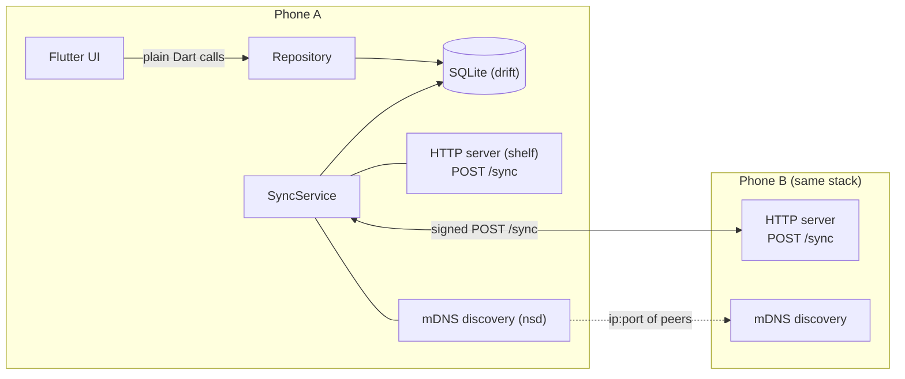
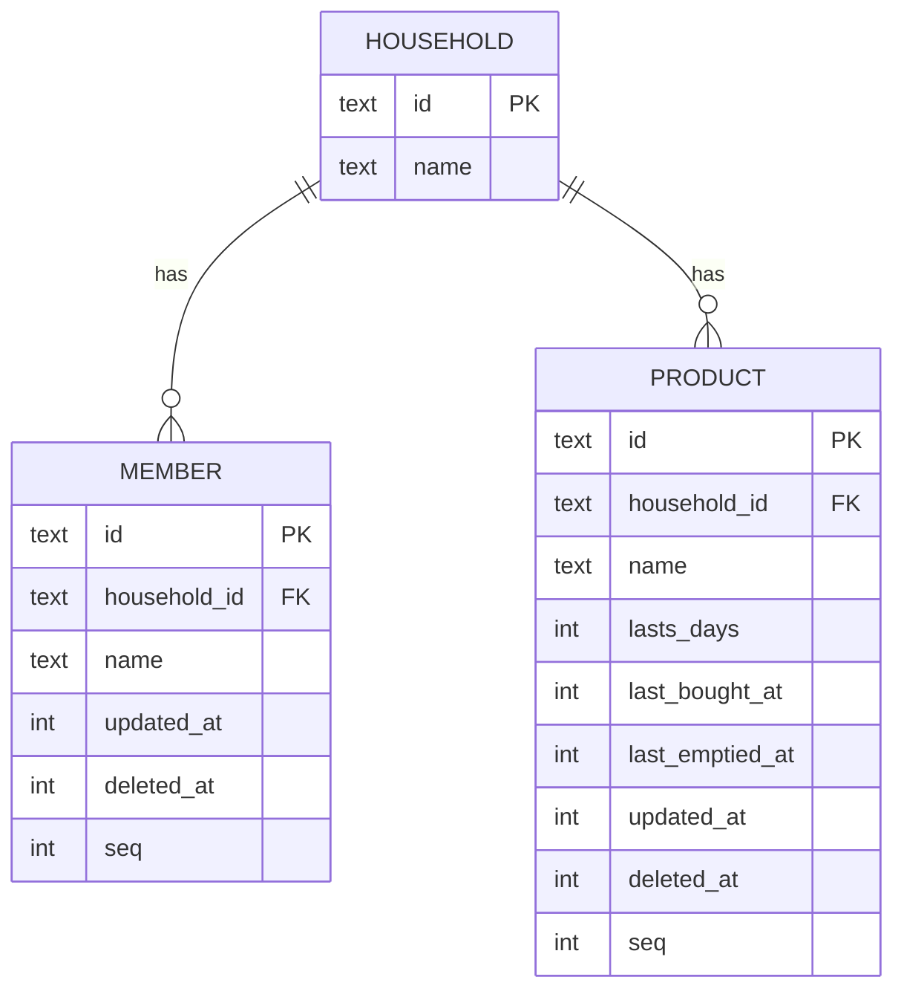
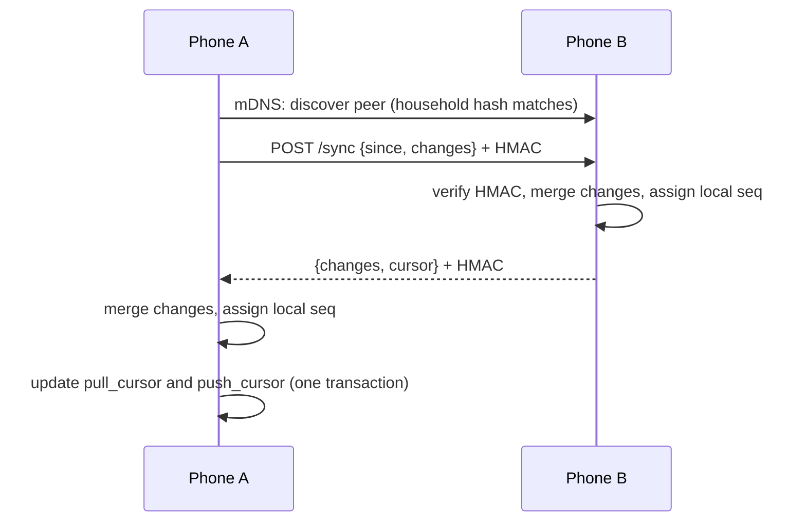

# No se que hay en la heladerApp

An app that remembers for you what needs to be bought for the house!

 
## 1. Requirements
 
### Functional
 
- **Shopping list**
  - Add products.
  - Each product has a "lifetime" (`lasts_days`); when it expires it shows up as *missing* automatically.
  - Mark a product as bought (one tap).
  - Mark a product as empty (one tap).
  - View the shopping list (what is missing).
  - Show empty products first

- **Sync with other people in the household**
  - Over local WiFi / LAN, no server, no third parties.
  - Consolidates the lists of everyone in the house.

### Non-functional
 
- Android first, iOS later (sisters have iPhones). Flutter, one codebase.
- Scale: 2 people now, designed for up to ~10 per household.
- Easy pairing: QR code, then automatic discovery.
- **CAP**: we choose Availability + Partition tolerance. The app always works offline; consistency is eventual. If an item gets bought twice, that's not a problem.
- **Zero friction**: every action is a tap. No quantities, no confirmation dialogs, no typing amounts.
- Only someone holding the household secret can join or sync (see [Security](#6-pairing-and-security)).

### Non-goals (v1)
 
- Quantities. A product lasts `lasts_days` whether you bought 1 or 20.
- Purchase history / analytics.
- Syncing when not on the same network.
- Real admin roles (nothing central can enforce them).


## 2. Architecture
 
Each phone is fully self-contained and works offline. Two phones sync directly when they can reach each other on the same network.
 

 
A standalone copy of this diagram is in [`architecture.svg`](./architecture.svg).
 
Key points:
 
1. **UI → backend is not HTTP.** UI and logic live in the same process, so the "API" is a Dart repository class. The only network-reachable endpoint is `POST /sync`.
2. **mDNS is discovery only.** It returns `ip:port` of peers in the household. The actual sync is a direct HTTP request to that address.
3. **Sync triggers**: app comes to foreground, a peer appears via mDNS, and after a local write (debounced). iOS can't sync in the background, and that's fine.

## 3. Data model
 
All ids are **UUIDs generated on the device** (no auto-increment ids, so offline devices never collide). Times are UTC epoch milliseconds.
 
```sql
CREATE TABLE household (
  id          TEXT PRIMARY KEY,
  name        TEXT NOT NULL
);
 
CREATE TABLE member (
  id            TEXT PRIMARY KEY,           -- also the device/install identity
  household_id  TEXT NOT NULL REFERENCES household(id),
  name          TEXT NOT NULL,
  updated_at    INTEGER NOT NULL,
  deleted_at    INTEGER,
  seq           INTEGER NOT NULL            -- local sync sequence, see §5
);
 
CREATE TABLE product (
  id               TEXT PRIMARY KEY,
  household_id     TEXT NOT NULL REFERENCES household(id),
  name             TEXT NOT NULL,
  lasts_days       INTEGER NOT NULL,
  last_bought_at   INTEGER,                 -- NULL = never bought
  last_emptied_at  INTEGER,                 -- NULL = never marked empty
  updated_at       INTEGER NOT NULL,        -- covers name, lasts_days, deleted_at
  deleted_at       INTEGER,                 -- soft delete
  seq              INTEGER NOT NULL
);
 
-- Local only, never synced
CREATE TABLE peer (
  member_id    TEXT PRIMARY KEY,
  pull_cursor  INTEGER NOT NULL DEFAULT 0,  -- highest of THEIR seq I have received
  push_cursor  INTEGER NOT NULL DEFAULT 0   -- highest of MY seq I have sent them
);
 
CREATE TABLE local_state (
  key    TEXT PRIMARY KEY,                  -- 'seq_counter', 'household_secret', ...
  value  TEXT NOT NULL
);
```
 

 
### Derived status (never stored)
 
There is no `in_fridge` column. It's computed when displaying:
 
```
needs_buying(p) =
     p.last_bought_at IS NULL
  OR p.last_emptied_at > p.last_bought_at
  OR now >= p.last_bought_at + p.lasts_days * 1 day
```
 
- Tap **Bought** → `last_bought_at = now`. That is later than any earlier `last_emptied_at`, so the product is no longer missing.
- Tap **Empty** → `last_emptied_at = now`. The product shows as missing immediately.
- No background job is needed to flip products to "missing", because the status is computed on read.
### Sync identity
 
- `member.id` doubles as the device id. One install = one member.
- Users are minimal: `id` + display name.

## 4. Merge rules
 
Merging is per row, when an incoming row `r` meets a local row `l` with the same id. These rules are **commutative, associative and idempotent**, so it doesn't matter in what order or how many times rows are applied.
 
| Field | Rule |
|---|---|
| `last_bought_at` | `max(l, r)` (NULL counts as smallest) |
| `last_emptied_at` | `max(l, r)` |
| `name`, `lasts_days`, `deleted_at` | take the whole group from the row with the greater `updated_at`; tie-break by the greater `member_id` of the last writer |
 
Consequences:
 
- Two people both buy milk offline: both timestamps arrive, the later one wins, and one purchase is "dropped". **This is accepted by design.**
- Buy and empty happen on different phones: both timestamps are kept, and the status is derived from the two. No lost update.
- Delete vs. edit: whoever has the later `updated_at` wins. It's a grocery list, so that's fine.
- Clock drift between phones can make a timestamp slightly wrong. Worst case is a product showing as missing a bit early or late. If it ever matters, upgrade `updated_at` to a hybrid logical clock; the schema doesn't change.


## 5. Sync protocol
 

 
Single endpoint, symmetric, one round trip:
 
```
POST /sync
Headers: X-Household: <hash of household id>
         X-Member:    <sender member id>
         X-Time:      <sender unix ms>
         X-Signature: HMAC-SHA256(secret, X-Time + "\n" + body)
 
Request body:
{
  "since":   <number>,        // my pull_cursor for you: send me your rows with seq > this
  "changes": [ <row>, ... ]   // my rows with seq > my push_cursor for you
}
 
Response body:
{
  "changes": [ <row>, ... ],  // your rows with seq > request.since
  "cursor":  <number>         // your current max seq
}
```
 
Each `row` is tagged with its table (`product` / `member`) and carries all of its columns except the sender's local `seq`.
 
### Why a local `seq` and not `updated_at` as the cursor
 
With more than two people, changes relay: A → B, then B → C. A relayed row still has its *old* `updated_at`, so a timestamp cursor on C's side would skip it. Instead, every device has a counter that increments **whenever a row is written locally or applied from a peer**, and stamps that row's `seq`. Cursors are per-peer positions in *the other device's* `seq` space.
 
### Algorithm (one side)
 
1. Discover peer via mDNS (or manual IP).
2. Build request: `since = peer.pull_cursor`, `changes = rows where seq > peer.push_cursor`.
3. Send, verify the signature on the response.
4. Apply `response.changes` with the merge rules, assigning each changed row a new local `seq`.
5. In one transaction: `peer.pull_cursor = response.cursor`, `peer.push_cursor = max seq that was sent`.
6. The server side does the symmetric steps when it receives a request.
Rows received from a peer may be echoed back on the next sync. That's harmless, since merging is idempotent. Optimize later if it matters.
 
## 6. Pairing and security
 
- **Household secret**: 32 random bytes created when the household is created.
- **Joining**: the existing member shows a QR code containing `{household_id, household_name, secret}` (plus an optional one-time expiry). The new member scans it and becomes a member. Nothing else is needed.
- **Membership model**: anyone holding the secret is a member. There are **no admin roles** in v1 because nothing central could enforce them. Any `admin` concept would only be a UI label.
- **Discovery**: advertise the mDNS service `_groceries._tcp` with a TXT record containing `hash(household_id)`. Phones only attempt to sync with peers advertising their own household hash. Other people's instances on the same network are ignored.
- **Authentication**: every request is signed with HMAC-SHA256 using the secret. Reject if the timestamp is more than ±5 minutes off (replay protection).
- **Known limitation**: v1 traffic is authenticated but **not encrypted**. Someone on your WiFi could read (not modify) list contents. Fine for groceries; if wanted later, add TLS with pinned certificates derived at pairing time.
- **Home WiFi (SSID)** is not used. Android requires location permission to read it, iOS requires entitlements, and SSIDs are not unique. The secret is what gates access, not the network name.

## 7. Repository API
 
```dart
abstract class GroceryRepository {
  Stream<List<Product>> watchProducts();          // all, with derived status
  Stream<List<Product>> watchShoppingList();      // only needs_buying == true
  Future<Product> addProduct(String name, int lastsDays);
  Future<void> updateProduct(String id, {String? name, int? lastsDays});
  Future<void> markBought(String id);             // last_bought_at = now
  Future<void> markEmpty(String id);              // last_emptied_at = now
  Future<void> deleteProduct(String id);          // soft delete
}
 
abstract class HouseholdRepository {
  Future<Household> createHousehold(String name, String myName);
  Future<Household?> current();
  Future<String> inviteQrPayload();               // household id + name + secret
  Future<void> joinFromQr(String payload, String myName);
  Stream<List<Member>> watchMembers();
}
```
 
Every write sets `updated_at = now` (for name/lasts/delete changes) or the relevant timestamp, and a new local `seq`.
 

## 8. Stack (Flutter)
 
| Concern | Package |
|---|---|
| SQLite | `drift` |
| HTTP server / client | `shelf`, `http` |
| mDNS discovery | `nsd` |
| QR | `qr_flutter` (show), `mobile_scanner` (scan) |
| IDs | `uuid` |
| HMAC | `crypto` |
| State management | `riverpod` (or whatever you prefer) |
 
**Android**: needs `INTERNET`, `ACCESS_WIFI_STATE`, `CHANGE_WIFI_MULTICAST_STATE`, and `NEARBY_WIFI_DEVICES` (Android 13+), plus camera for QR.
**iOS (later)**: `NSLocalNetworkUsageDescription`, `NSBonjourServices` (`_groceries._tcp`), `NSCameraUsageDescription`. Building needs a Mac. A free Apple ID is enough to test on your own device (the app expires after 7 days); TestFlight/App Store distribution needs the $99/yr developer account.
 
## 9. Build order
 
1. **Schema + repository** with drift. No UI, no network.
2. **Merge logic**: `getChangesSince(cursor)` and `applyChanges(rows)`. Unit-test with two in-memory DBs, including these cases:
   - same product edited on both sides
   - buy on A, empty on B
   - delete vs. edit
   - relay A → B → C
   - applying the same batch twice (idempotency)
3. **Minimal UI**: product list, add, bought/empty taps, shopping list view.
4. **Household + QR pairing.**
5. **Sync server + signed requests**, tested between two emulators or one emulator and one phone.
6. **mDNS discovery** and sync on foreground / on peer found.
7. **Polish**: peer status indicator, manual-IP fallback, error handling.
8. **iOS**: permissions, test on a real iPhone.

## 10. Open questions
 
- Should `lasts_days` have sensible defaults or suggestions per product name? at the bare minimum, the interface should suggest 3 days, 5 days, a week, or an input to type in days.
- Do we want a "last synced with X" indicator in the UI? (Probably yes: otherwise sync failures are invisible.)
- What happens if someone leaves the household? With a shared secret, the only real answer is rotating it and re-pairing everyone. Probably fine to ignore in v1.
